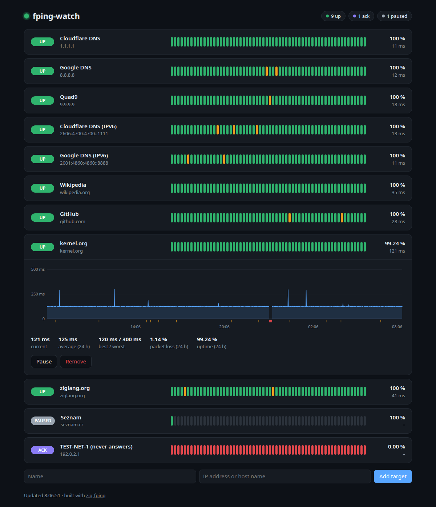

# fping-watch

A small ping monitor built on the `zig_fping` library: a daemon that pings a
handful of targets once a minute and serves a web page with the last 24 hours.



<sub>Sample data: one target paused, one acknowledged, one row expanded.</sub>

- one row per target with its status, a strip of recent cycles (green: all
  replies, orange: some lost, red: all lost), 24-hour uptime and current latency;
- click a row for the 24-hour latency chart with packet loss underneath;
- add, remove and **pause** targets; **acknowledge** a DOWN target the way
  Nagios does: it shows ACK instead of DOWN until 5 cycles in a row are not DOWN
  again, so the next outage is reported;
- `--read-only` for a public demo: the server refuses every change (HTTP 403),
  and the page hides the controls.

Writable is the default: you run it for yourself, on loopback. The public
demo is the same package with one setting changed ([Deploying](#deploying)).

It is the library's example application and a public demo, finished for that
purpose and deliberately kept small enough to read in one sitting:
`src/monitor.zig` (targets, probing, history, persistence), `src/main.zig`
(HTTP server and API), `src/web/` (the page; no framework and no build step,
embedded into the binary). Nothing beyond Zig's standard library and
`zig_fping`. It ships as a Debian package with a sandboxed systemd service
([Deploying](#deploying)).

## Build and run

Needs Zig 0.17.0. Inside this repository the library comes from the checkout
(`build.zig.zon` depends on `../..`):

```sh
zig build                     # ReleaseSafe by default
./zig-out/bin/fping-watch --targets targets.json --history history.json
# open http://127.0.0.1:8080
```

| option | default | |
|---|---|---|
| `--listen ADDR:PORT` | `127.0.0.1:8080` | web server address |
| `--targets FILE` | `targets.json` | target list; rewritten on every change; a writable instance without it starts empty |
| `--history FILE` | (memory only) | the 24-hour history, saved after every cycle; an unreadable one is moved to `FILE.bad` |
| `--read-only` | off | refuse every change |
| `--allow-host NAME` | | a writable instance also answers to this host name (repeatable), see below |
| `--cycle SECONDS` | `60` | seconds between cycles (the tests use 5) |
| `--version` | | print the version and exit |

Pinging needs ICMP sockets: either unprivileged ones
(`sysctl net.ipv4.ping_group_range` covering your group, the default on most
distributions) or `CAP_NET_RAW`.

Files are written through a temporary file that is synced to disk before it
replaces the old one, so a crash or power loss never leaves a truncated list
or history.

`targets.json` needs only names and hosts; ids, `paused` and `acked` are added
when the daemon saves it:

```json
{ "targets": [
  { "name": "Cloudflare DNS", "host": "1.1.1.1" },
  { "name": "Wikipedia", "host": "wikipedia.org" }
] }
```

## How a cycle works

Every cycle (aligned to the wall clock) takes a copy of the active targets,
resolves names, and pings all of them in **one** `Pinger` round in `.count`
mode: 5 echo requests per target, 1 s apart per target, 20 ms apart globally,
with a random start offset of up to 500 ms per target. That is the library's
pacing at work: the probes are spread out, never burst into the network. The
results are recorded under a lock: probes sent, replies, and the median
round-trip time. The web UI therefore never waits for a cycle.

History is a ring of 1440 slots per target, indexed by cycle number, so a gap
(daemon stopped, target paused) needs no bookkeeping: a slot whose timestamp is
not the expected one is shown as "no data".

## API

| | |
|---|---|
| `GET /api/state` | everything the page shows: per target status, flags and the 24 h series `rtt` (ms) and `loss` (%), one entry per cycle, oldest first, `null` = no data; carries an ETag, `If-None-Match` gets `304` until the state changes |
| `POST /api/targets` | add: `{"name": "...", "host": "..."}` |
| `DELETE /api/targets/ID` | remove |
| `POST /api/targets/ID/pause`, `/resume` | stop and resume probing |
| `POST /api/targets/ID/ack`, `/unack` | acknowledge a DOWN target, or withdraw the acknowledgement |
| `GET /healthz` | `200 {"ok":true,...}` while cycles keep finishing (at most 3 cycles apart) and the ICMP socket opens; `503` otherwise. Unreachable targets do not count: they are what is being monitored |

Changes must be sent as `application/json`: a cross-site HTML form cannot do
that without a CORS preflight, which the server never approves, so a page on
another site cannot change the targets behind your back.

## Scope

Kept out on purpose, so the example stays small; they belong to a real
monitoring product, not to a library demo:

- **No authentication.** Without `--read-only`, anyone who reaches the port can
  change the targets. The default address is loopback; the public instance runs
  read-only.
- **Names resolve one after another**, each with the resolver's own timeout
  (5 s, 2 attempts). With a dead DNS server and many names a cycle gets
  longer, and `/healthz` reports 503 once cycles are 3 minutes apart;
  numeric addresses never wait.
- **One request per connection, no TLS.** Each connection is served on its own
  thread and closed after one response. A reverse proxy in front provides
  keep-alive, TLS and compression, and the host's protection (CrowdSec,
  fail2ban) per-client limits.
- **At most 64 targets**, one address per name (the first one DNS returns).
- History is saved as JSON after every cycle (about 400 KB for 10 targets).

## Many viewers, and the open internet

Viewers only read: probing runs on its own schedule, and no request ever
sends a ping, however many people have the page open.

- **One serialization per change.** The state JSON is built once per cycle
  (or target change) and served to every viewer from a cache. The page polls
  every 15 s with `If-None-Match`, so most polls are a body-less `304`; a
  background tab does not poll at all. Measured with 64 targets (a 930 KB
  state): 50 concurrent clients, 2000 full responses in 3.4 s, 12 threads,
  7 MB RSS.
- **Bounded connections.** At most 256 at once (more are closed unanswered),
  each shut down 10 s after it was accepted, so a client that never finishes
  its request cannot hold a thread for longer. A flood of idle connections
  still fills the 256 slots for as long as it lasts; the proxy, which
  waits for a complete request before it connects here, and per-client
  limits in front of it are the answer to that.
- **Nothing to change, nothing to read.** `--read-only` refuses every write
  in the server, not just in the page; the routes are a fixed list (no file
  serving, no path handling); every string reaches the page through
  `textContent`, under a CSP without inline script.

Without `--read-only`, anyone who reaches the server can make it ping
addresses of their choice, including ones on your internal network, and read
which ones answer. Never expose a writable instance.

Loopback alone does not keep web pages out: a page on another site can point
its own host name at 127.0.0.1 (DNS rebinding) and then talk to the server
as its own origin, past the JSON content type check. So a writable instance
answers only when the `Host` header is an IP address, `localhost`, or a
name given with `--allow-host` (behind your own authenticating proxy, say);
anything else gets `421`. A read-only instance answers to any name: it
changes nothing and shows only what it publishes.

Everything in `targets.json` (names *and* host addresses) is public on a
read-only instance; list only targets you are happy to show.

The state is about 15 KB per target, a long run of small numbers that
compresses well: enable compression in the proxy (`encode` below).

## Deploying

Every zig-fping release carries `fping-watch_<version>_amd64.deb` and
`_arm64.deb` (built by `package.sh`; checksums in `SHA256SUMS`). The binary is
static; the package needs only `init-system-helpers`, which every Debian or
Ubuntu with systemd has.

```sh
sha256sum -c --ignore-missing SHA256SUMS
apt install ./fping-watch_1.0.0_amd64.deb
```

That installs, enables and starts `fping-watch.service` on `127.0.0.1:8080`,
writable and with no targets yet: open the page and add them (on a server,
through a tunnel: `ssh -L 8080:127.0.0.1:8080 server`).

| path | |
|---|---|
| `/usr/bin/fping-watch` | the binary |
| `/usr/lib/systemd/system/fping-watch.service` | the service ([deploy/fping-watch.service](deploy/fping-watch.service)) |
| `/etc/fping-watch/env` | optional settings, below |
| `/var/lib/fping-watch/targets.json` | the target list the page edits (systemd `StateDirectory`) |
| `/var/lib/fping-watch/history.json` | the history |
| `/usr/share/fping-watch/targets.json` | a sample list: public resolvers and sites, IPv4 and IPv6 |
| `/usr/share/fping-watch/Caddyfile` | a Caddy site to start from ([deploy/Caddyfile](deploy/Caddyfile)) |

Settings go in `/etc/fping-watch/env` (then `systemctl restart fping-watch`):

| variable | default | |
|---|---|---|
| `FPING_WATCH_LISTEN` | `127.0.0.1:8080` | the web server address |
| `FPING_WATCH_TARGETS` | `/var/lib/fping-watch/targets.json` | the target list; a read-only instance points it at a file you manage, such as `/etc/fping-watch/targets.json` |
| `FPING_WATCH_OPTS` | (none) | further options: `--read-only`, `--allow-host NAME` |

Upgrades restart the service (and leave it alone if you disabled it).
`apt remove` keeps the settings, the list and the history; `apt purge`
deletes them.

The service runs as a throwaway user (`DynamicUser`) that can write only its
state directory, with no capabilities at all and under a strict sandbox:
seccomp `@system-service`, IPv4/IPv6 sockets only, a private user namespace,
no writable-executable memory, read-only system, `TasksMax` and `MemoryMax`
(`systemd-analyze security fping-watch`: 1.3, "OK").

ICMP goes through unprivileged ping sockets, which
`net.ipv4.ping_group_range` must allow for the service's group. systemd's
own defaults (`/usr/lib/sysctl.d/50-default.conf`, on Debian and Ubuntu)
allow every group; `sysctl net.ipv4.ping_group_range` shows what a host has.
Where they do not, `/healthz` reports `"probing_ok":false` and the journal
`probing failed: PermissionDenied`: allow ping sockets in `/etc/sysctl.d/`,
or give the service raw sockets instead (`systemctl edit fping-watch`):

```ini
[Service]
AmbientCapabilities=CAP_NET_RAW
CapabilityBoundingSet=CAP_NET_RAW
# A capability inside a private user namespace does not reach the host's network.
PrivateUsers=no
```

### A public read-only demo

With Ansible: the settings first, then the package, so the service never
runs writable; the health check then insists on read-only.

```yaml
- name: fping-watch settings directory
  ansible.builtin.file: { path: /etc/fping-watch, state: directory, mode: "0755" }
- name: fping-watch settings
  ansible.builtin.copy:
    dest: /etc/fping-watch/env
    mode: "0644"
    content: |
      FPING_WATCH_LISTEN=127.0.0.1:8080
      FPING_WATCH_TARGETS=/etc/fping-watch/targets.json
      FPING_WATCH_OPTS=--read-only
  notify: restart fping-watch
- name: fping-watch targets
  ansible.builtin.copy: { src: targets.json, dest: /etc/fping-watch/targets.json, mode: "0644" }
  notify: restart fping-watch
- name: fping-watch package
  ansible.builtin.get_url:
    url: https://github.com/zaxified/zig-fping/releases/download/vX.Y.Z/fping-watch_1.0.0_amd64.deb
    dest: /var/cache/fping-watch_1.0.0_amd64.deb
    # Pinned from the release's SHA256SUMS: a checksum fetched along with
    # the package would prove nothing.
    checksum: "sha256:<the hash from SHA256SUMS>"
- name: fping-watch installed
  ansible.builtin.apt: { deb: /var/cache/fping-watch_1.0.0_amd64.deb }
- name: fping-watch is healthy and read-only
  ansible.builtin.uri: { url: "http://127.0.0.1:8080/healthz" }
  register: health
  until: health.status == 200 and health.json.read_only
  retries: 10
  delay: 2
```

Then publish it through the reverse proxy, compressed:

```caddyfile
ping.example.org {
	encode zstd gzip
	reverse_proxy 127.0.0.1:8080
}
```

Caddy has no per-client rate limits without a plugin; on the open internet
let the host's protection (CrowdSec, fail2ban) watch the proxy's log. The
sample list pings IPv6 addresses too: on a host without IPv6 they stay DOWN,
so leave them out there.

## About page

For a page that lists several demos, the package carries a description of
this one in `/usr/share/fping-watch/about/` (`zig build about` writes the same
into `zig-out/about/`), generated from [deploy/about.json](deploy/about.json):

| file | |
|---|---|
| `about-card.html` | an HTML fragment to include: one `<article class="demo" id="demo-fping-watch">`, no styles, no scripts; class names (`demo-title`, `demo-tagline`, `demo-screenshot`, `demo-summary`, `demo-features`, `demo-facts`, `demo-source`) for the hub to style, schema.org `SoftwareApplication` microdata, `data-version` |
| `about.html` | the same card as a standalone page (light and dark) |
| `about.json` | the same data plus `version`, for templating |
| `screenshot.png` | referenced by both pages relatively, keep it next to them |

None of them links to the demo itself: only the hub knows its URL. With
Ansible, after the package is installed on the same host:

```yaml
- name: fping-watch about card
  ansible.builtin.copy:
    src: /usr/share/fping-watch/about/
    dest: "{{ demo_hub_root }}/fping-watch/"
    remote_src: true
```

## Tests

```sh
zig build test     # unit tests: status, acknowledgement, history ring, cache, health, persistence, Host guard, validation, escaping
sh smoke.sh        # end to end: loopback targets, API, ETag, health, Host guard, deadline, read-only mode
./package.sh       # the .deb packages; smoke-tests the packaged binary first
```

Inside the repository `scripts/test.sh` runs the first two, the smoke test in
an isolated network namespace; `scripts/release.sh` runs `package.sh`.
